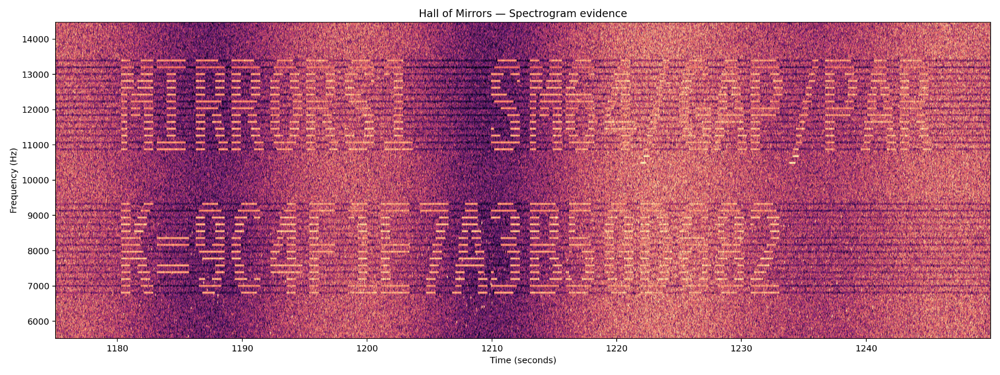
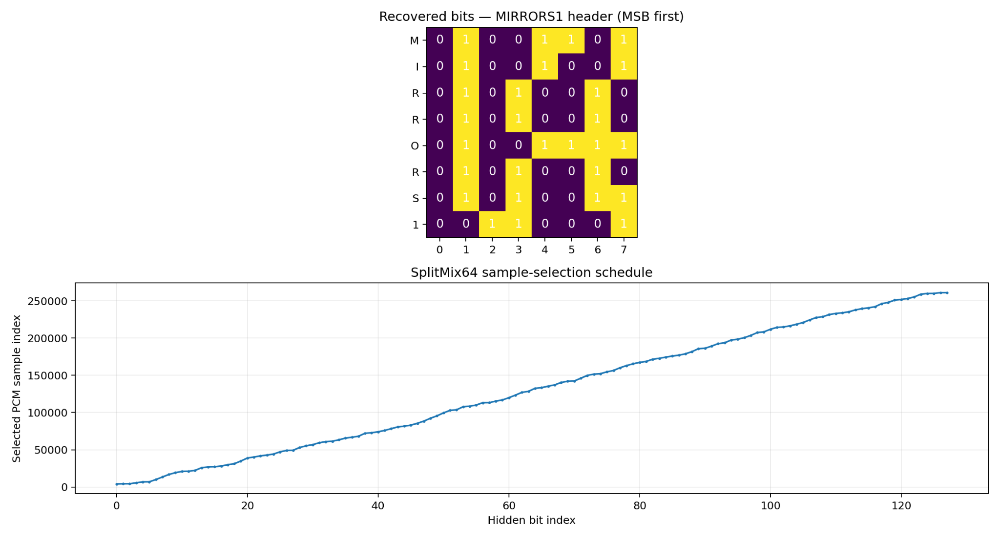
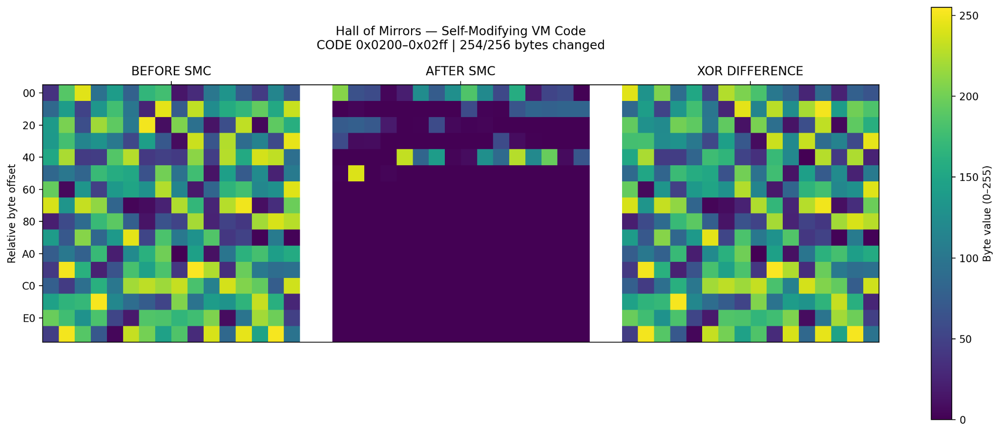
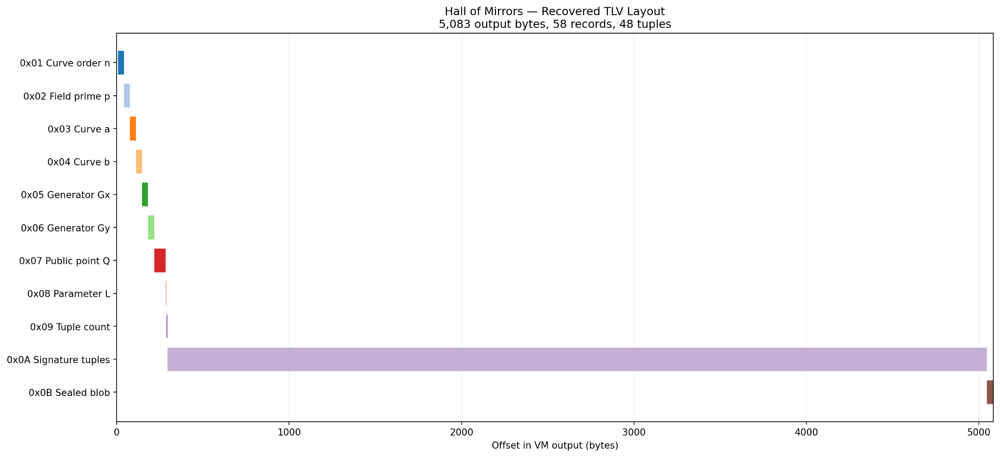
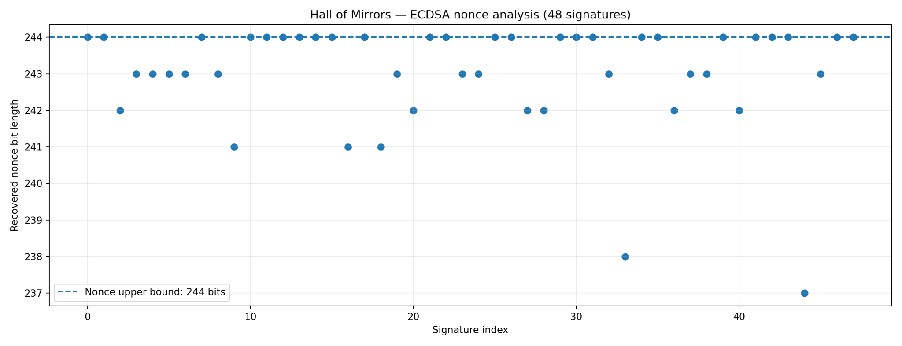

# Hall of Mirrors Writeup — HI Cyber Con 2026 CTF

**Flag:** `hiCTF{h1dd3n_numb3r_l4ttice_le4k}`

## 1. Challenge description

> A field recording from the atrium — twenty-six minutes of rain on glass, wind, and a drone that never quite resolves. The ensemble swears nothing was added in post. The archivist disagrees: she says the room is answering itself, and that if you look at the recording instead of listening to it, you can see where. Every reflection in here points at another one. Only one of them points out.

The provided recording looks like an audio-steganography problem. In fact, it contains a seed for a hidden-bit extractor, which leads to a self-modifying virtual machine, an ECDSA nonce-leakage problem, and finally an encrypted flag.

## 2. TL;DR

1. Read `K=9C4F1E7A3B50D682` from the WAV's spectrogram.
2. Use that seed with **MirrorStego v1** to extract 6,266 bytes and verify their CRC32.
3. Run the **MVM1** virtual machine, including its fetch-dependent hash and self-modifying CODE instructions.
4. Parse the VM's 5,083-byte output: it contains 48 valid secp256k1 ECDSA signatures, a parameter `L = 12`, and a 33-byte encrypted blob.
5. Exploit the **12 leading zero bits of the ECDSA nonces** with a 27-dimensional LLL/CVP lattice, verify the private key against the public point, and decrypt the blob.

The included `solve.py` takes the *original WAV* and reproduces the entire chain:

```text
[+] Extracted 6266 bytes (CRC OK)
[+] VM output: 5083 bytes
[+] ECDSA signatures: 48, L=12
[+] Private key recovered, Q=dG verified
[+] FLAG: hiCTF{h1dd3n_numb3r_l4ttice_le4k}
```

## 3. Files and first observations

The challenge came with `hall-of-mirrors.zip` (containing `hall-of-mirrors.wav`) and `archivist-datasheet.zip` (containing `archivist_datasheet.txt`). The [datasheet text](data/archivist_datasheet.txt) and [original hint ZIP](data/archivist-datasheet.zip) are included; the large WAV is not.

The original challenge ZIP has SHA-256 `b83e44399c1103b1dcea13690349fa6493360a0c2ac5cc0b4fad4c882ab4c7e0` (verified against the supplied archive). This checksum is useful when reproducing the solve independently.

The recording is a **26-minute stereo 16-bit PCM WAV at 48 kHz**. Its `data` chunk begins at offset 216 and contains 299,520,000 audio bytes. The metadata is consistent with a field recording, but the description is the real hint: *look* at the sound.

The datasheet describes three protocols: **MirrorStego v1** for audio extraction, **MVM1** for running the hidden payload, and a **TLV/KDF/cipher** format for unsealing the final message. The extraction algorithm is specified, but its 64-bit seed `K` is missing.

## 4. A seed in the spectrogram

I inspected the audio as a spectrogram, focusing on the higher-frequency bands. Around **1,180–1,240 seconds**, characters appear in the noise. The upper line contains `MIRRORS1`; the lower line supplies the seed.



*Figure 1 — The hidden text is visible between approximately 7 and 14 kHz. The lower line supplies the SplitMix64 seed.*

```text
K=9C4F1E7A3B50D682
```

The spectrogram does **not** contain the flag. It tells us how to extract the payload from the PCM samples.

## 5. Extracting the hidden frame

MirrorStego reads the WAV samples as **interleaved little-endian 16-bit integers**. Starting with `p = -1`, it makes two SplitMix64 draws for every extracted bit. The first selects a new sample index; the second supplies an XOR mask. The following is the extraction rule in plain Python notation:

```python
# One hidden bit. SplitMix64 returns a fresh 64-bit value on each call.
draw1 = next_splitmix64()
p += 1 + (draw1 % 4096)

draw2 = next_splitmix64()
mask = (draw2 >> 17) & 0xff
low_byte = pcm_data[2 * p]     # Low byte of the p-th interleaved int16
bit = (low_byte ^ mask).bit_count() & 1
```

Eight bits are packed **most-significant-bit first** into one output byte. Reading consecutive LSBs or splitting the stereo channels would therefore produce the wrong data. The PRNG itself uses the usual SplitMix64 state increment and two 64-bit mixing multiplications; the complete implementation is in `solve.py`.



*Figure 2 — The first 64 extracted bits form `MIRRORS1`; the sample indices follow the pseudorandom selection schedule.*

The decoded frame has the structure:

```text
MIRRORS1 (8 B) | payload length (u32 LE) | CRC32 (u32 LE) | payload
```

It yielded:

```text
Magic:           MIRRORS1
Payload length:  6266 bytes
Expected CRC32:  E2046FB1
Computed CRC32:  E2046FB1
Result:          PASS
```

Matching the CRC32 validated the full extraction. The payload started with `4D 56 4D 31`, or `MVM1` in ASCII.

## 6. Executing MVM1

The `MVM1` image has a 16-byte header, followed by separate CODE and DATA areas:

| Field | Value |
|---|---:|
| CODE length | 6,107 bytes |
| DATA length | 143 bytes |
| Entry point | `0x0000` |
| Register file | 16 unsigned 64-bit registers |
| CODE / DATA address spaces | 64 KiB each |
| Call stack | 256 entries |

MVM1 has ordinary arithmetic, memory, and branch instructions, but also `PCH` (patch one CODE byte) and `SMC` (modify a range of CODE bytes). That is why static disassembly alone is insufficient.

### 6.1 The bootstrap

The initial instructions are small enough to include directly:

```text
0000  IMM R0, 0x0000000000000001
000A  JZ  R0, 0x0100
000E  IMM R1, 0x0000000000000200
0018  IMM R2, 0x5048414E544F4D00
0022  SMC R1, R2, length=0x0100
0026  JMP 0x0200
```

Because `R0` is 1, the branch is not taken. The VM modifies 256 CODE bytes beginning at `0x0200` and then jumps into that region. No screenshot of the disassembly is necessary: the exact bytes and their implications are visible here.

### 6.2 Why the instruction sequence matters

`R15` begins at `0xCBF29CE484222325`. **Before every fetched opcode executes**, MVM1 updates it:

```python
h = ((R[15] ^ opcode) * 0x100000001B3) & ((1 << 64) - 1)
R[15] = h ^ (h >> 31)
```

`SMC` seeds its generator using `R[rs] XOR R15`, then applies an xorshift-derived XOR stream to CODE. The hash depends on which instructions were fetched and in what order. A wrong branch or a missing hash update changes the decrypted instructions.

For the first `SMC`, I obtained:

```text
Instruction PC:  0x0022
R15:             0x701D39E6A6BBB13D
SMC seed:        0x205578A8F2F4FC3D
Target:          0x0200
Region length:   256 bytes
Changed:         254/256 bytes
```



*Figure 3 — The first SMC operation transforms a scrambled region into executable instructions. The XOR-difference panel makes the modification visible.*

The transformed bytes begin with valid instructions: `MOV R3, R15`, `IMM R4, 0x9E3779B97F4A7C15`, and `MUL R3, R4`. I ran the VM with a mutable CODE array and updated `R15` before decoding each instruction. Execution reached `HLT` and emitted **5,083 bytes**, starting with `MIRRORS1`.

## 7. The VM output is an ECDSA dataset

After `MIRRORS1`, the VM output contains **TLV records**: `type (u8) | length (u16 LE) | value`, terminated by type `0x00`.

| Type | Contents | Count |
|---|---|---:|
| `01`–`06` | secp256k1 curve order, prime, coefficients, generator | 6 |
| `07` | Public point `Q` (64 bytes) | 1 |
| `08` | Parameter `L = 12` | 1 |
| `09` | Signature count | 1 |
| `0A` | Signature tuple (96 bytes each) | 48 |
| `0B` | Encrypted blob (33 bytes) | 1 |

There are **58 records** in total. The curve is **secp256k1**, with equation:

$$
y^2\equiv x^3+7\pmod p
$$



*Figure 4 — The 48 ECDSA records occupy almost all the 5,083-byte output; the sealed blob is at the end.*

Each 96-byte tuple is three 32-byte **big-endian** integers. Testing the possible orders against the public key showed that the fields are `(z, r, s)`: a message-hash integer and the two ECDSA signature components. **All 48 signatures verified** with the public key from the TLV. The values are saved in [`data/hom_signature_tuples.csv`](data/hom_signature_tuples.csv).

## 8. Recovering the private key from biased nonces

For each ECDSA signature, the private scalar `d`, nonce `k_i`, message hash `z_i`, signature `(r_i, s_i)` and curve order `n` satisfy:

$$
s_i\equiv k_i^{-1}(z_i+r_i d)\pmod n
$$

Rearranging and defining two known values gives:

$$
a_i=z_i s_i^{-1}\bmod n,\qquad t_i=r_i s_i^{-1}\bmod n
$$

$$
k_i\equiv a_i+t_i d\pmod n
$$

The TLV parameter `L = 12` suggested a nonce restriction. The successful interpretation was **12 leading zero bits**:

$$
0<k_i<2^{256-12}=2^{244}
$$

The same unknown `d` appears in all 48 modular equations, but each nonce must fall into a much shorter interval than a full-sized random ECDSA nonce. This is a **Hidden Number Problem** (HNP).

### The lattice

For `m` signatures, take `W = 2^12` and `U = 2^244`. I constructed an `(m+1)`-dimensional integer lattice with basis:

$$
B=\begin{pmatrix}
nW&0&\cdots&0&0\\
0&nW&\cdots&0&0\\
\vdots&\vdots&\ddots&\vdots&\vdots\\
0&0&\cdots&nW&0\\
t_0W&t_1W&\cdots&t_{m-1}W&1
\end{pmatrix}
$$

and target vector:

$$
\mathbf{u}=\left((U/2-a_0)W,\ldots,(U/2-a_{m-1})W,n/2\right)
$$

In the script, divisions by two are integer divisions. I reduced the basis with **LLL** and found a nearby lattice point with **CVP** (`fpylll`); the last coordinate gives a candidate for `d`. I then checked it against the public point, rather than assuming a nearest-vector result was correct.

```python
LLL.reduction(B, delta=0.99)
near = CVP.closest_vector(B, target)
d = int(near[-1]) % n
P = SECP256k1.generator * d
assert P.x() == qx and P.y() == qy
```

The attack succeeded using **26 signatures**, so the actual lattice was **27-dimensional**. The recovered scalar was:

```text
0x278c1c0ea08921ba895d3d4c971e4e0a8c8b29d8016f42d9861fe49c6fa826c6
```

The point check `Q = dG` passed. Reconstructing the nonce for **all 48 signatures** also confirmed the hypothesis: every nonce was below `2^244`, and they did not all have 12 trailing zero bits.



*Figure 5 — Every reconstructed nonce is at most 244 bits long, confirming the leading-zero bias.*

## 9. Decrypting the sealed blob

The private key is not itself the flag. The final TLV contains a 33-byte blob encrypted with the datasheet's custom KDF and stream generator.

The KDF processes the **32-byte big-endian** private scalar for four rounds, starting from `0x4D6972726F72734B`. Each round applies FNV-style multiplication, XOR shifts, and a fixed 64-bit multiplier, then outputs eight **big-endian** bytes. The resulting 32-byte key is:

```text
a34c6fd7c69371c4c72e14d046b00a2c147f00067dfff01aaec8ef0097d10fdc
```

The cipher interprets the key as four **little-endian** 64-bit words. It mixes them with additions, XORs, and rotations by 32, 24, 16, and 37 bits. Each block emits eight bytes from `(a XOR c)`; XORing that keystream against the sealed blob produces:

```text
hiCTF{h1dd3n_numb3r_l4ttice_le4k}
```

Both the KDF and cipher are implemented in `solve.py`, without hardcoding the recovered key or plaintext.

## 10. Run the solver

The archive deliberately **does not include** the ~300 MB WAV. Download the original challenge archive, extract the WAV beside `solve.py`, and run:

```bash
unzip -o hall-of-mirrors.zip
python3 solve.py hall-of-mirrors.wav
```

`solve.py` includes the **spectrogram-derived seed**, but it independently extracts the payload, executes the VM, performs the lattice attack, checks the private scalar, and decrypts the flag. It does **not** use the CSV or the intermediate binaries.

This repository also includes the original hint text, the 48 recovered signature tuples, and two small binary checkpoints for anyone who wants to inspect the stages without processing the whole WAV.

```text
Hall-of-Mirrors-Writeup/
├── README.md
├── solve.py
├── requirements.txt
├── assets/                    # Five distinct figures used above
├── data/
│   ├── archivist_datasheet.txt
│   ├── archivist-datasheet.zip
│   ├── hom_curve.json
│   ├── hom_signature_tuples.csv
│   └── hom_sealed.bin
├── evidence/
│   ├── mirror_payload.bin     # Extracted 6,266-byte MVM1 image
│   └── hom_vm_output.bin      # VM output, 5,083 bytes
└── tools/                     # Optional analysis/verification scripts
```

For reproducibility, `python3 tools/verify_crypto.py` checks the recovered ECDSA values, nonce bound, and blob decryption. `tools/inspect_vm.py` and `tools/plot_crypto.py` reproduce the SMC and crypto plots from the included checkpoints. These plotting utilities additionally require `numpy` and `matplotlib` (`python3 -m pip install numpy matplotlib`); they are **not** needed by `solve.py`.

## 11. Takeaways

The layers each have their own independent check: the audio extraction has a magic and CRC32, the VM terminates with a structured output, the ECDSA signatures verify, the lattice result satisfies `Q = dG`, and the reconstructed nonces meet the proposed bound. The last decryption produces the flag.

The important cryptographic weakness is **nonce quality**, not an invalid signature or a broken elliptic curve. All 48 ECDSA signatures were valid; enough partial information about their nonces was sufficient to recover the signing key. The audio and VM layers made that evidence difficult to reach, but did not change the underlying vulnerability.

## 12. References

- [Hall of Mirrors — original challenge archive](https://hicon26-files-b19d71.nbg1.your-objectstorage.com/hall-of-mirrors/b42e8eb4c72bc9ff/hall-of-mirrors.zip)
- [Archivist's Hardware Datasheet — hint archive](https://hicon26-files-b19d71.nbg1.your-objectstorage.com/archivist-datasheet/7d3ac61906f17e41/archivist-datasheet.zip)
- [Sonic Visualiser](https://www.sonicvisualiser.org/)
- [Howgrave-Graham and Smart, *Lattice Attacks on Digital Signature Schemes* (2001)](https://research.ibm.com/publications/lattice-attacks-on-digital-signature-schemes)
- [Minerva: The Curse of ECDSA Nonces](https://eprint.iacr.org/2020/728)
- [RFC 6979 — Deterministic ECDSA](https://www.rfc-editor.org/rfc/rfc6979)
- [fpylll](https://github.com/fplll/fpylll) and [python-ecdsa](https://github.com/tlsfuzzer/python-ecdsa)
